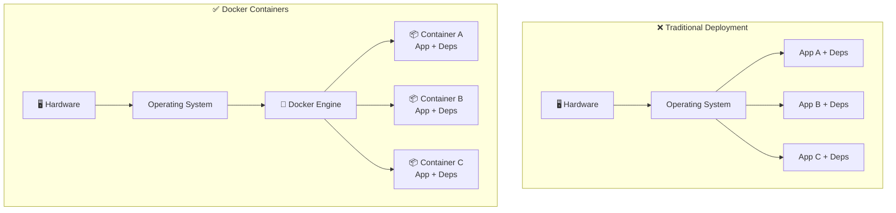

# 🐳 Docker Basics

A hands-on introduction to **Docker** — learn the fundamentals of containerization through practical examples.

---

## Introduction - What is Docker?

**Docker** is an open-source platform that allows you to **package, distribute and run applications** inside lightweight, portable units called **containers**.

A container bundles your application together with everything it needs to run — code, runtime, libraries and system tools — so it works **the same way on any machine**, whether it's your laptop, a teammate's computer or a cloud server.

### The Problem Docker Solves

Ever heard _"It works on my machine!"_? That's the classic problem Docker eliminates:

```
❌  Without Docker:
    Developer A (Windows) → works fine
    Developer B (macOS)   → missing library, crashes
    Production (Linux)    → different version, unexpected behavior

✅  With Docker:
    Developer A → runs the same container → works
    Developer B → runs the same container → works
    Production  → runs the same container → works
```

### Containers vs. Traditional Deployment



In the **traditional approach**, all applications share the same OS and can have conflicting dependencies. With **Docker**, each application runs in its own **isolated container** with its own dependencies — no conflicts, no surprises.

### Images and Containers

A key concept in Docker is the distinction between **images** and **containers**:

- A **Docker Image** is a read-only **blueprint** (or template) that contains everything needed to run an application: the code, the runtime, the libraries, the environment variables, and the configuration files. Think of it like a **recipe** — it describes *what* to build, but it's not the running dish itself.

- A **Docker Container** is a **running instance** of an image. When you launch an image, Docker creates a container from it — an isolated, lightweight process that executes your application. You can run **multiple containers** from the same image, just like you can cook the same recipe multiple times.

```
  📄 Dockerfile       →  🏗️ Build  →   🖼️ Image        →  ▶️ Run  →   📦 Container
  (instructions)         (docker build)  (read-only        (docker run)  (running
                                          template)                       instance)
```

Images can be:
- **Built** from a `Dockerfile` — a text file with step-by-step instructions
- **Pulled** from a registry like [Docker Hub](https://hub.docker.com/), where thousands of pre-built images are available (e.g. `python`, `node`, `postgres`, `ubuntu`)

### Volumes

By default, any data created inside a container is **lost** when the container is removed. **Volumes** solve this problem — they provide **persistent storage** that lives outside the container's lifecycle.

A volume is a directory on the host machine that is **mounted** (linked) into a container. This means:
- Data **survives** even if the container is deleted and recreated
- Multiple containers can **share** the same volume
- You can easily **back up** and migrate data

```
  🖥️ Host Machine                   📦 Container
  ┌──────────────────┐              ┌──────────────────┐
  │  📁 /my-data     │◄────────────►│  📁 /app/data    │
  │  (volume)        │   mounted    │                  │
  └──────────────────┘              └──────────────────┘
       ✅ Data persists                 Container can be
          on the host                   removed & recreated
```

> **Example:** A database container (e.g. PostgreSQL) uses a volume to store its data files. Even if you stop, remove, and recreate the container, the database content is still there.

### Networks

Containers are **isolated by default** — they can't communicate with each other unless you connect them through a **Docker network**.

A network creates a private communication channel where containers can find and talk to each other **by name**, without exposing ports to the outside world.

```
  🌐 Docker Network: "my-app-network"
  ┌─────────────────────────────────────────────┐
  │                                             │
  │   📦 web-app  ◄──────────►  📦 database    │
  │   (port 3000)    network     (port 5432)    │
  │                                             │
  └─────────────────────────────────────────────┘
        │
        │ exposed to host
        ▼
   🖥️ localhost:3000
```

> **Example:** A web application container needs to connect to a database container. By placing them on the same Docker network, the web app can reach the database simply by using `database:5432` as the connection address — Docker handles the internal DNS resolution.

### Why Docker Matters for Data Science

- **Reproducibility** — Share your exact environment so others can reproduce your results
- **Isolation** — Each project has its own dependencies without polluting your system
- **Portability** — Move your work seamlessly between local machines, servers, and the cloud
- **Collaboration** — Your entire team runs the exact same setup with a single command
